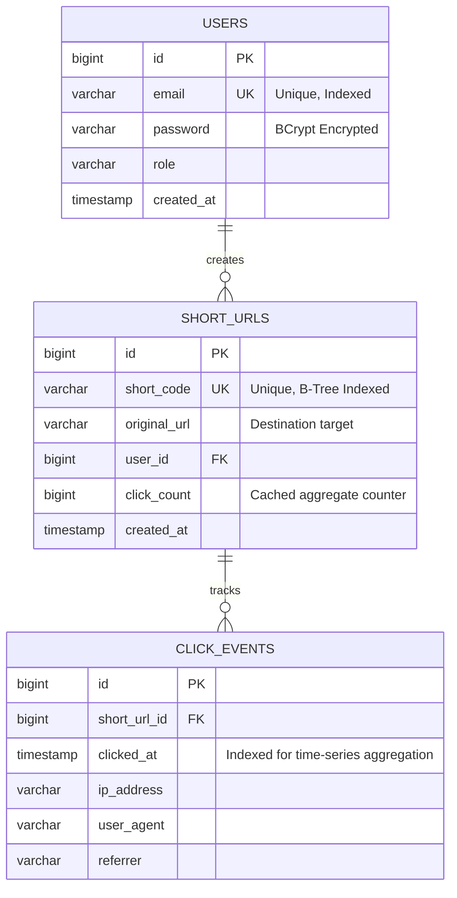

# ⚡ LinkSnap: Scalable URL Shortener & Real-Time Analytics Engine

[](https://github.com/sindesamith294/url-shortener-realtime-analytics/actions/workflows/ci.yml)
[](https://openjdk.org)
[](https://spring.io/projects/spring-boot)
[](https://react.dev)
[](https://vitejs.dev)
[](https://www.postgresql.org)
[](https://opensource.org/licenses/MIT)

> A production-grade URL shortening and click-stream analytics platform engineered with **Java 21**, **Spring Boot 3**, **React 19**, and **PostgreSQL**. Features sub-millisecond $O(1)$ redirection lookups, stateless JWT authentication, and real-time timeline data visualization.

---

## 📑 Table of Contents
- [Architecture Overview](#-architecture-overview)
- [Key Engineering Decisions](#-key-engineering-decisions)
- [Data Model & ER Diagram](#-data-model--er-diagram)
- [Features](#-features)
- [API Reference](#-api-reference)
- [Local Development Setup](#-local-development-setup)
- [Automated Testing & CI/CD](#-automated-testing--cicd)
- [Production Deployment](#-production-deployment)
- [License](#-license)

---

## 🏗️ Architecture Overview

The system follows a clean, decoupled 3-tier architecture with an API gateway pattern and stateless token authorization:

```mermaid
graph TD
    subgraph Client Tier
        Browser["Web Browser (React 19 SPA)"]
        PublicUser["Public Web Traffic"]
    end

    subgraph Application Tier
        Vite["Vite Reverse Proxy (:5173)"]
        SecurityFilter["Spring Security 6 (JwtAuthFilter)"]
        AuthCtrl["AuthController (/api/auth)"]
        UrlCtrl["UrlController (/api/urls)"]
        RedirectCtrl["RedirectController (/{shortCode})"]
        AnalyticsCtrl["AnalyticsService (/analytics)"]
    end

    subgraph Data Tier
        Postgres[("PostgreSQL 16 Database")]
        Index[("B-Tree Index on short_code")]
    end

    Browser -->|REST API Requests| Vite
    Vite --> SecurityFilter
    PublicUser -->|Click Short URL| RedirectCtrl
    SecurityFilter --> AuthCtrl
    SecurityFilter --> UrlCtrl
    SecurityFilter --> AnalyticsCtrl

    UrlCtrl --> Postgres
    AnalyticsCtrl --> Postgres
    RedirectCtrl -->|O(1) Lookup| Index
    RedirectCtrl -->|302 Temporary Redirect| PublicUser
    RedirectCtrl -.->|Async Click Event Logging| Postgres
```

---

## 💡 Key Engineering Decisions

### 1. $O(1)$ Redirection Lookup Strategy
Redirect operations form >90% of traffic in URL shortening systems. To ensure sub-millisecond response times:
- Unique B-Tree indexing is enforced directly on the `short_code` column in PostgreSQL.
- URL lookups query exclusively indexed columns, bypassing full-table scans.
- HTTP `302 Found` status is returned rather than `301 Moved Permanently` to ensure intermediate browser caches do not bypass analytics capture.

### 2. Base62 Encoding vs. Hash Truncation
Instead of standard MD5/SHA-256 truncation (which incurs collision probability requiring retry loops):
- Unique short codes utilize alphanumeric Base62 charset (`[0-9a-zA-Z]`).
- Generates compact 6-to-8 character paths providing over **$62^6 \approx 56.8 \text{ billion}$** unique URLs without collisions.
- Supports customizable aliases with duplicate validation and structured exception handling.

### 3. Stateless JWT Authentication & Security
- Employs **JJWT 0.12.5** with HMAC-SHA256 signature verification.
- Completely stateless backend session management (`SessionCreationPolicy.STATELESS`), allowing seamless horizontal autoscaling across multiple container instances.
- Password hashing powered by **BCrypt** with adaptive workload factor.

### 4. Database-Level Analytics Aggregation
- Timeline analytics avoid in-memory filtering. Click events are aggregated directly in PostgreSQL using native date-truncation queries (`DATE(c.clicked_at)`).
- Significantly lowers JVM heap memory usage and database wire payload sizes for URLs with tens of thousands of clicks.

---

## 🗄️ Data Model & ER Diagram



---

## ✨ Features

- **⚡ Instant URL Shortening**: High-throughput shortening with automatic collision avoidance.
- **🎯 Custom Branded Slugs**: Users can customize short links (e.g., `linksnap.app/custom-slug`).
- **📊 Real-Time Interactive Analytics**:
  - Daily click timeline visualizer powered by **Recharts**.
  - Top-performing URLs ranked by total traffic volume.
  - Granular audit trail capturing timestamps, referrers, and user agents.
- **🛡️ Secure Access**: Granular user authorization ensures users can only inspect, edit, or delete their own shortened links.
- **🎨 Glassmorphic Dark UI**: Tailored responsive dashboard built with React 19, Lucide React icons, and accessible component states.

---

## 🌐 API Reference

### 🔐 Authentication Endpoints

#### Register a New User
```bash
curl -X POST http://localhost:8080/api/auth/register \
  -H "Content-Type: application/json" \
  -d '{"email":"dev@example.com","password":"StrongPassword123"}'
```
**Response (`200 OK`)**:
```json
{
  "token": "eyJhbGciOiJIUzI1NiIsIn...",
  "email": "dev@example.com"
}
```

#### User Login
```bash
curl -X POST http://localhost:8080/api/auth/login \
  -H "Content-Type: application/json" \
  -d '{"email":"dev@example.com","password":"StrongPassword123"}'
```

---

### 🔗 URL Management Endpoints
*(Requires `Authorization: Bearer <JWT_TOKEN>`)*

#### Create Short URL
```bash
curl -X POST http://localhost:8080/api/urls \
  -H "Authorization: Bearer <JWT_TOKEN>" \
  -H "Content-Type: application/json" \
  -d '{
    "originalUrl": "https://github.com/sindesamith294/url-shortener-realtime-analytics",
    "customCode": "linksnap-demo"
  }'
```
**Response (`201 Created`)**:
```json
{
  "id": 1,
  "shortCode": "linksnap-demo",
  "shortUrl": "http://localhost:8080/linksnap-demo",
  "originalUrl": "https://github.com/sindesamith294/url-shortener-realtime-analytics",
  "clickCount": 0,
  "createdAt": "2026-10-21T08:00:00Z"
}
```

#### Fetch Analytics for a URL
```bash
curl -X GET http://localhost:8080/api/urls/1/analytics \
  -H "Authorization: Bearer <JWT_TOKEN>"
```
**Response (`200 OK`)**:
```json
{
  "urlId": 1,
  "shortCode": "linksnap-demo",
  "totalClicks": 1420,
  "dailyClicks": [
    {"date": "2026-10-19", "clicks": 320},
    {"date": "2026-10-20", "clicks": 540},
    {"date": "2026-10-21", "clicks": 560}
  ],
  "recentClicks": [
    {
      "clickedAt": "2026-10-21T08:14:22Z",
      "referrer": "https://linkedin.com",
      "userAgent": "Mozilla/5.0 (Windows NT 10.0; Win64; x64)"
    }
  ]
}
```

---

## 🚀 Local Development Setup

### Prerequisites
- **JDK 21** or higher
- **Node.js 18+** & npm
- **PostgreSQL 14+** (Local test profile uses an automated in-memory H2 database)

### Quick Development URLs
| Service | Localhost URL | Notes |
|:---|:---|:---|
| **Frontend UI** | [http://localhost:5173](http://localhost:5173) | React 19 + Vite Web Application |
| **Backend API** | [http://localhost:8080](http://localhost:8080) | Spring Boot REST API & Redirection |
| **Health Check** | [http://localhost:8080/actuator/health](http://localhost:8080/actuator/health) | Backend Actuator Health Status |

---

### 1. Run Backend (Spring Boot 3)
```bash
cd backend

# Execute using Maven
mvn clean spring-boot:run
```
*The Spring Boot server starts on `http://localhost:8080`.*

---

### 2. Run Frontend (React 19 + Vite)
```bash
cd frontend

# Install dependencies
npm install

# Start Vite dev server with proxy enabled
npm run dev
```
*The client application starts on `http://localhost:5173` with automated `/api` proxying.*

---

## 🧪 Automated Testing & CI/CD

The repository includes a comprehensive automated test suite and continuous integration pipeline:

- **Integration Testing**: Powered by `@SpringBootTest` and `@Transactional` rollbacks with in-memory H2 persistence (`UrlServiceIntegrationTest.java`).
- **CI/CD Pipeline**: GitHub Actions workflow automatically builds, tests, and verifies both frontend and backend on every commit and pull request.

```bash
# Run backend test suite locally
cd backend
mvn test
```

---

## ☁️ Production Deployment

Configured for one-click deployment on **[Railway](https://railway.app)**:

1. Connect this repository to your Railway project.
2. Provision a **PostgreSQL** database service in Railway.
3. Configure Environment Variables:
   - `DATABASE_URL`: Automatically populated by Railway PostgreSQL plugin.
   - `JWT_SECRET`: 256-bit secure key.
   - `APP_BASE_URL`: Public domain URL for generating shortened links.
   - `VITE_API_URL`: Backend public domain passed to frontend build.

---

## 📄 License

This project is open-source and available under the [MIT License](LICENSE).

---

### 👨‍💻 Author & Contact
**Samith Sinde**  
GitHub: [@sindesamith294](https://github.com/sindesamith294)  
Email: [sindesamith294@gmail.com](mailto:sindesamith294@gmail.com)
